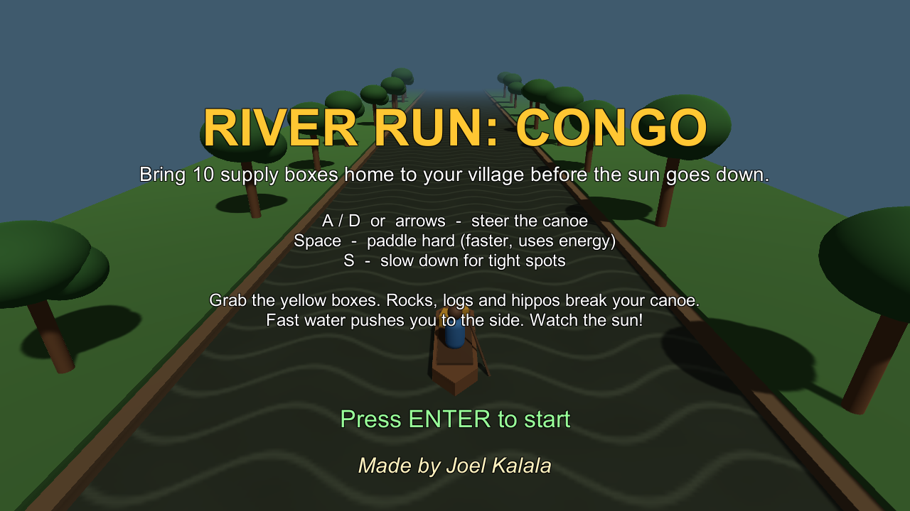
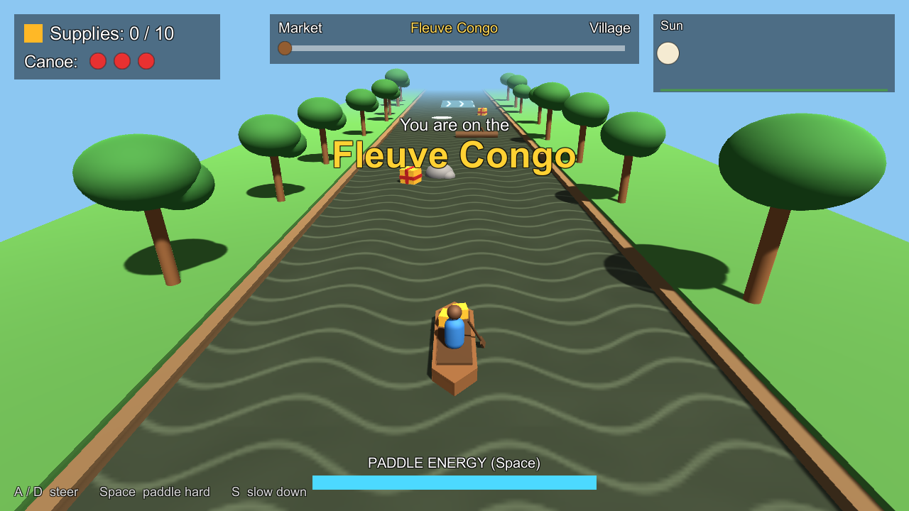
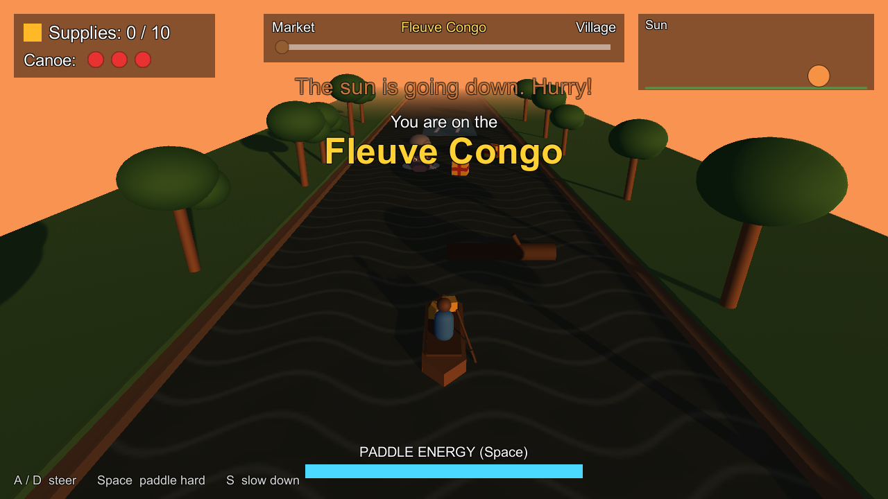
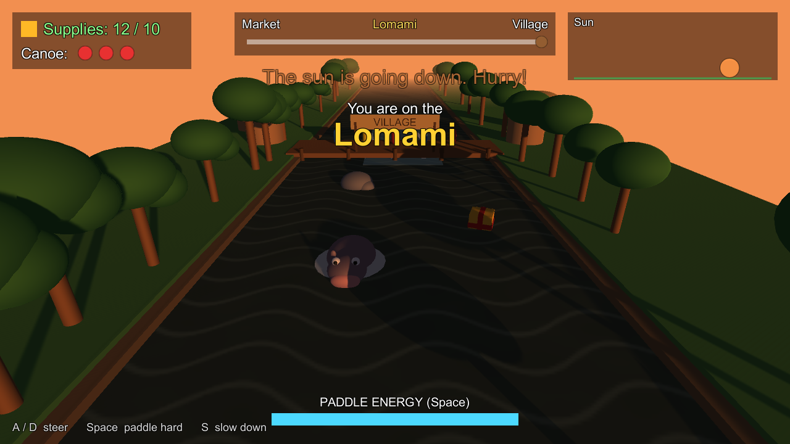

# River Run: Congo

*Made by Joel Kalala*. This is my final game prototype for COS 212 (Unity Game Development) at the University of Southern Maine.

> Steer a wooden canoe down the Congo River and bring supplies home to your village before the sun goes down.

## The game

You are a young man coming back from the market in a canoe full of food and medicine for your village.
The river is dangerous: rocks, floating logs, hippos that pop up from the water, and fast currents.
The trip passes through six Congo rivers: **Fleuve Congo, Mai-Ndombe, Kasai, Ubangi, Lualaba and Lomami**.
The national anthem *Debout Congolais* plays during the trip.

| | |
|---|---|
| **Objective** | Bring at least 10 supply boxes to the village dock before dark |
| **Win** | Reach the village before the sun goes down with 10 or more boxes |
| **Lose** | Night falls, the canoe breaks (3 hits), or you get home with fewer than 10 boxes |

### Controls
| Key | Action |
|---|---|
| A / D or arrows | Steer the canoe |
| Space | Paddle hard (faster, uses energy) |
| S | Slow down for tight spots |
| Enter | Start |
| R | Play again |

### Core mechanics
- The canoe always moves forward with the river.
- **The sun is the timer.** There is no number clock: the sun goes down and the light turns orange, then red.
- 3 health points, a paddle energy bar, and a supply box counter.
- Supply boxes are often right next to danger, so you choose: grab it or stay safe.

## How to open
1. Install **Unity 2022.3.62f2** (Unity Hub).
2. Unity Hub → **Add project from disk** → choose this folder.
3. Open `Assets/Scenes/Main.unity` and press **Play**.

## Credits
- Game design and project: Joel Kalala
- National anthem *Debout Congolais* (music by Simon-Pierre Boka di Mpasi Londi): recording by the United States Navy Band, public domain in the US
- Built in Unity using techniques from *Sams Teach Yourself Unity Game Development in 24 Hours*
- Built with help from Claude (an AI assistant by Anthropic)
